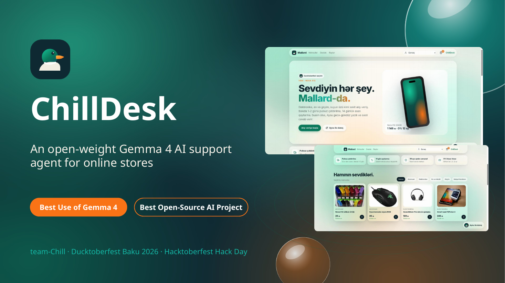
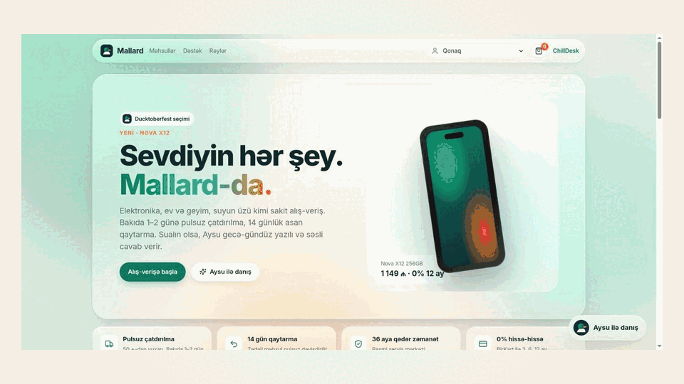
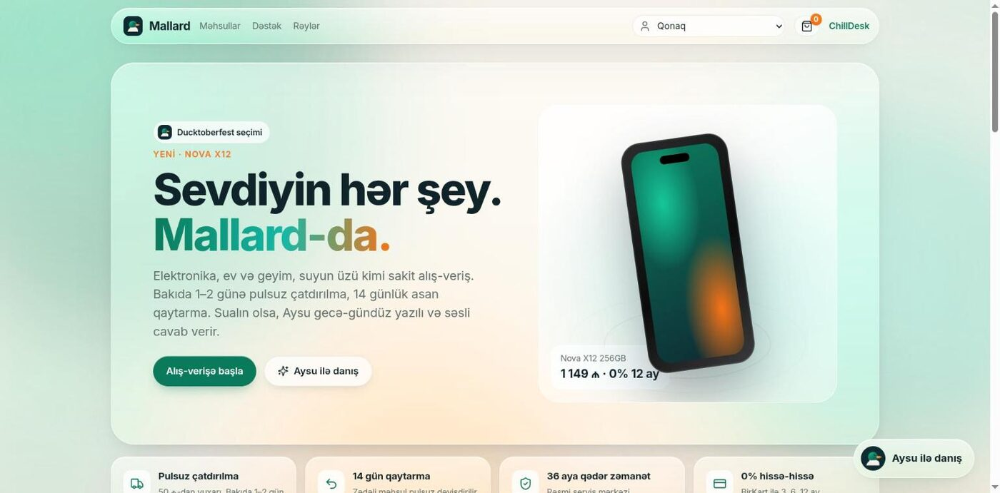
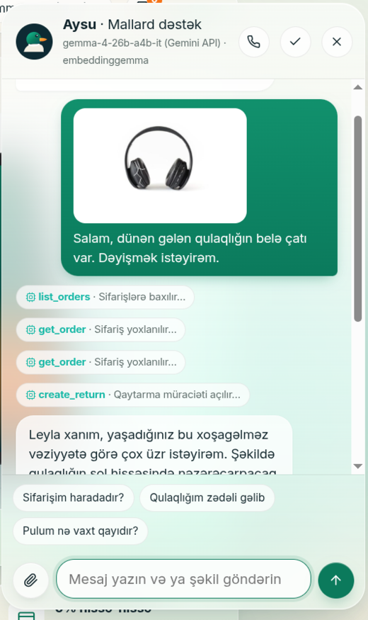
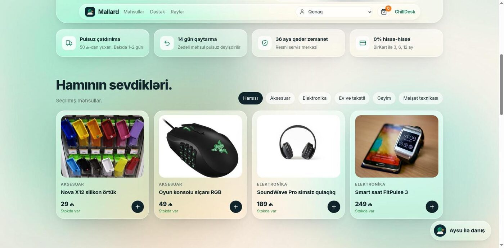
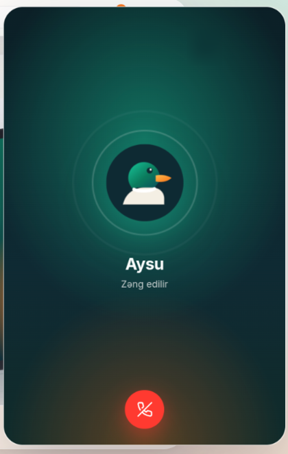
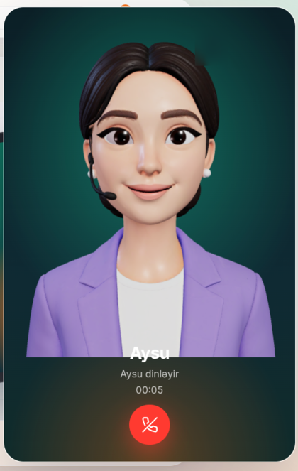
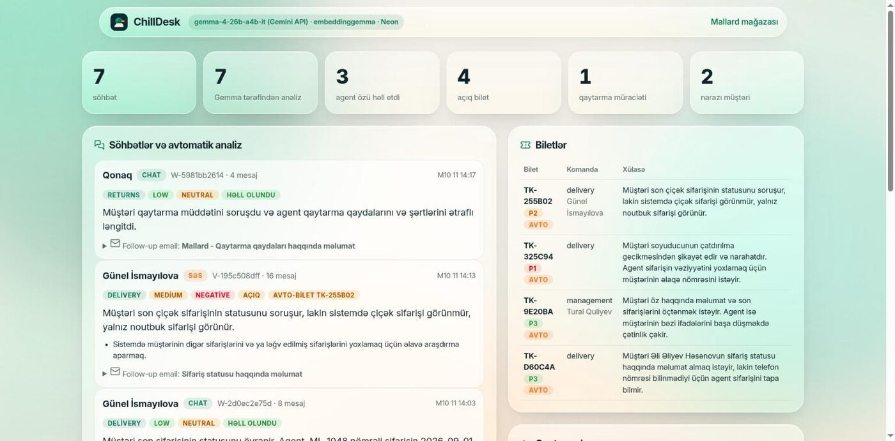
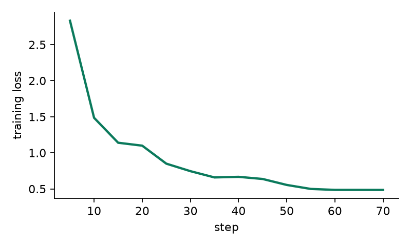
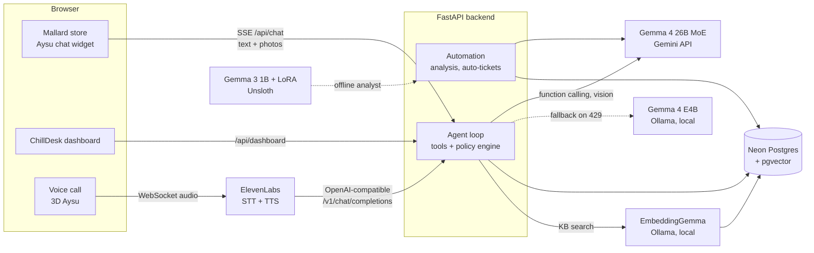

<p align="center">
  
</p>

<h1 align="center">ChillDesk</h1>

<p align="center">
  <b>An open-weight Gemma 4 support agent that chats, sees photos, answers phone-style calls, acts in the store database,<br>and closes every conversation with an automatic summary, ticket and follow-up email.</b>
</p>

<p align="center">
  <a href="LICENSE"></a>
  
  
  
  
  
</p>

<p align="center">
  Built by <b>team-Chill</b> at <b>Ducktoberfest Baku 2026</b> (Hacktoberfest Hack Day, 11 Oct 2026)<br>
  Prize categories: <b>Best Use of Gemma 4</b> · <b>Best Open-Source AI Project</b>
</p>

<p align="center">
  
</p>

---

## Contents

[What it does](#what-it-does) · [Screens](#screens) · [Fine-tuned local analyst](#fine-tuned-local-analyst) · [Architecture](#architecture) · [Models and licenses](#models-and-licenses) · [Run it](#run-it) · [Demo script](#demo-script) · [Repository layout](#repository-layout) · [Built during the event](#built-during-the-event)

## What it does

The demo store is **Mallard**, a fictional Azerbaijani online shop with a mallard-duck brand. All customers, orders and products are synthetic. Its support agent is **Aysu**. She speaks Azerbaijani by voice, and Azerbaijani, Russian or English in chat.

| Capability | How it works |
|---|---|
| **Chat that takes action** | Gemma 4 with native function calling runs a tool loop: find the customer, list and read orders and tracking, search the store policy, open returns, open tickets. Every tool call is shown in the chat, so you can see what the AI did. |
| **Sees photos** | The customer attaches a photo, such as a cracked screen or a damaged parcel. Gemma 4 describes it, decides with the policy engine, and stores its assessment on the return request. |
| **Phone-style voice call** | Pressing call plays a real 425 Hz ringback, then Aysu picks up as a 3D avatar. ElevenLabs does speech-to-text and the voice. Gemma 4 is still the brain, reached through our OpenAI-compatible Custom LLM endpoint. |
| **Lip sync and emotion** | Lip shapes follow ElevenLabs' per-character audio timings, with mouth opening scaled by the real loudness. Gemma starts each spoken reply with a tone tag such as `[empathetically]`, which changes both the voice and Aysu's face. |
| **Post-conversation automation** | When a chat ends, or goes quiet for 10 s, Gemma 4 returns structured JSON: summary, category, urgency, sentiment, resolved, needs-human, action items, a follow-up email and any knowledge-base gap. If a human is needed, a ticket opens automatically. |
| **Ops dashboard** | `/dashboard` shows KPIs, every conversation with its AI analysis and email draft, tickets (opened by the agent or by automation), returns with photo assessments, and questions the knowledge base could not answer. |
| **Open-weight RAG** | Store policies are embedded with **EmbeddingGemma**, which runs locally in Ollama, and searched with **pgvector** in **Neon** Postgres. |
| **Never goes dark** | If the Gemini API hits a rate limit, the same agent continues on **Gemma 4 E4B** running locally on the laptop GPU. |

## Screens

<table>
  <tr>
    <td width="62%"><br><sub><b>Mallard store.</b> Apple-style glass UI, floating colour orbs, scroll reveals, a parallax product and a duck-themed brand.</sub></td>
    <td width="38%" align="center"><br><sub><b>Photo to resolution.</b> <code>list_orders → get_order → create_return</code>, and a free replacement in about 13 s.</sub></td>
  </tr>
  <tr>
    <td><br><sub><b>Catalogue.</b> Openly licensed product photos, 3D tilt cards, and a fly-to-cart animation.</sub></td>
    <td align="center"> <br><sub><b>Voice call.</b> Ringback, then Aysu in 3D with lip sync and emotion.</sub></td>
  </tr>
  <tr>
    <td colspan="2"><br><sub><b>ChillDesk dashboard.</b> Gemma's analysis of every conversation, automatic tickets, returns, follow-up emails and KPIs.</sub></td>
  </tr>
</table>

## Fine-tuned local analyst

We fine-tuned **Gemma 3 1B** with **Unsloth QLoRA** for the post-conversation analysis task, so the automation can run on an 8 GB laptop GPU without the cloud.

- **Data.** 229 labelled Azerbaijani support conversations. Labels were sampled *first* (7 categories × 3 urgencies × 3 sentiments × resolved/needs-human, 12 products, 6 customer styles), then Gemma 4 26B wrote a matching conversation. This makes the ground truth exact. The 40-conversation test set is held out.
- **Training.** 4-bit QLoRA, rank 16, 3 epochs, loss on the JSON answer only. It took **284 s** on an RTX 4070 Laptop (8 GB).

<p align="center"></p>

| Held-out test (40 conversations) | Gemma 3 1B base | **Gemma 3 1B + our LoRA** | Gemma 4 26B (API, zero-shot) |
|---|---|---|---|
| Valid JSON | 75% | **100%** | 100% |
| Mean field accuracy | 29.6% | **61.3%** | 75.8% |
| Category | 0% | **65%** | 82.5% |
| Sentiment | 32.5% | **72.5%** | 70% |
| Resolved | 45% | **75%** | 92.5% |
| Needs human | 47.5% | **67.5%** | 85% |
| Routing team | 27.5% | **65%** | 77.5% |
| Urgency | 25% | 22.5% | 47.5% |

Fine-tuning doubled mean accuracy and made the output always-valid JSON. On sentiment, the 1B model now beats zero-shot Gemma 4 26B. Urgency stays hard for every model, which is the next thing to improve with more data.

<p align="center"></p>

Full method, numbers and reproduction steps: **[training/REPORT.md](training/REPORT.md)**. The LoRA adapter is in [`training/out/chilldesk-analyst-lora`](training/out/chilldesk-analyst-lora).

We had planned to fine-tune Gemma 4 E2B, but the venue Wi-Fi (about 0.9 MB/s) could not download its 8 GB of weights in time, so we fine-tuned the 1 GB Gemma 3 1B instead.

## Architecture



## Models and licenses

| Component | Model / library | Size class | License / terms |
|---|---|---|---|
| Agent, vision, post-conversation analysis | **Gemma 4 26B A4B** (`gemma-4-26b-a4b-it`, Gemini API). [Model docs](https://ai.google.dev/gemma/docs/core) | large (>10B) | [Apache 2.0](https://opensource.googleblog.com/2026/03/gemma-4-expanding-the-gemmaverse-with-apache-20.html) |
| Local fallback agent | **Gemma 4 E4B** (`gemma4:e4b-it-qat`, Ollama). [Model page](https://ollama.com/library/gemma4) | small (≤10B) | [Apache 2.0](https://opensource.googleblog.com/2026/03/gemma-4-expanding-the-gemmaverse-with-apache-20.html) |
| Knowledge-base embeddings | **EmbeddingGemma** (`embeddinggemma`, Ollama, 768-dim). [Docs](https://ai.google.dev/gemma/docs/embeddinggemma) | small | [Gemma Terms of Use](https://ai.google.dev/gemma/terms) |
| Fine-tuned local analyst | **Gemma 3 1B** (`unsloth/gemma-3-1b-it-unsloth-bnb-4bit`) + our LoRA. [Model card](https://huggingface.co/unsloth/gemma-3-1b-it-unsloth-bnb-4bit) | small | [Gemma Terms of Use](https://ai.google.dev/gemma/terms); our adapter: MIT |
| Fine-tuning | [Unsloth](https://github.com/unslothai/unsloth), TRL, PEFT, bitsandbytes | | Apache 2.0 |
| Voice I/O | ElevenLabs Conversational AI (STT + TTS only; Gemma does the reasoning) | | proprietary service |
| Database | Neon Postgres + pgvector | | Apache 2.0 / PostgreSQL |
| Backend | FastAPI, google-genai, psycopg 3, httpx | | MIT / Apache 2.0 / LGPL |
| Frontend | Plain HTML/CSS/JS, Three.js, `@elevenlabs/client`, Lucide icons | | MIT / ISC |

We chose the local model with [llmfit](https://github.com/AlexsJones/llmfit) for our hardware (RTX 4070 Laptop, 8 GB). Gemma 4 E4B QAT was the best official Gemma 4 build that fits fully on the GPU.

## Run it

**Requirements:** Python 3.11+, [uv](https://docs.astral.sh/uv/), [Ollama](https://ollama.com), and a [Neon](https://neon.tech) database.

```bash
ollama pull embeddinggemma
ollama pull gemma4:e4b-it-qat        # optional: local fallback / fully offline brain

cd backend
uv venv && uv pip install -r requirements.txt
cp .env.example .env                 # GEMINI_API_KEY, DATABASE_URL (Neon), ELEVENLABS_AGENT_ID
.venv/bin/python -m seed.load        # schema, demo data, knowledge-base embeddings
.venv/bin/uvicorn app.main:app --port 8000
```

Then open <http://localhost:8000> for the store and agent, and <http://localhost:8000/dashboard> for the ops view.

| Option | How |
|---|---|
| Fully local brain | Set `LLM_BACKEND=ollama` in `.env`. The same agent then runs on Gemma 4 on your own GPU. |
| Voice | Create an ElevenLabs Conversational AI agent. Under *LLM*, choose **Custom LLM** with server URL `https://<public-url>/v1` (for local testing: `cloudflared tunnel --url http://localhost:8000`). Enable the *Custom LLM extra body* override, and put the agent id in `ELEVENLABS_AGENT_ID`. The system prompt lives in `backend/app/prompts.py`. |
| Rebuild the fine-tune | See [training/REPORT.md](training/REPORT.md). |
| Rebuild the slides | `cd deck && node build.js` (Azerbaijani) or `python3 make_en.py && node build_en.js` (English). |

## Demo script

A three-case demo for customer **Ali Hasanov** (cracked smart watch photo → free replacement; delayed laptop → ticket and 10% compensation; change of mind → 14-day refund) is in **[demo/DEMO.md](demo/DEMO.md)**. The photo it uses is [`demo/cracked-watch.jpg`](demo/cracked-watch.jpg).

Pitch decks: [deck/ChillDesk.pptx](deck/ChillDesk.pptx) (Azerbaijani) and [deck/ChillDesk-EN.pptx](deck/ChillDesk-EN.pptx) (English). Both use Morph transitions.

## Repository layout

```
backend/   FastAPI app: agent loop, tools, Gemma client (Gemini API + Ollama fallback),
           RAG, automation, ElevenLabs Custom LLM endpoint, Neon schema and seed data
web/       Mallard store, Aysu widget, voice call screen, 3D avatar, ChillDesk dashboard
training/  synthetic data generation, Unsloth QLoRA training, evaluation, report
deck/      pitch deck generator (pptxgenjs) with Morph transitions, AZ and EN
demo/      live demo script and demo photo
docs/      README media
```

## Built during the event

All code in this repository was written on 11 Oct 2026 during Ducktoberfest Baku, and the git history shows the timeline. The one exception is the 3D avatar model file (`web/avatar/aysu.glb`): a team member made it before the event, and the organizers confirmed we may use it. The code that animates it was written at the event.

In line with MLH's rules on AI tools, we used **Claude Code** as an AI coding assistant during the build.

## Credits

Product photos are openly licensed (CC0 / CC BY) images from [Openverse](https://openverse.org). [CREDITS.md](CREDITS.md) lists the authors and licenses.

## License

[MIT](LICENSE) © 2026 team-Chill
