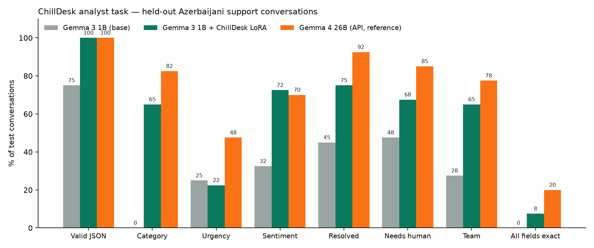

# Fine-tuning a 1B Gemma for ChillDesk

**Goal:** run ChillDesk's post-conversation analysis on a small, local, open-weight model (8 GB laptop GPU) instead of a large hosted model, without losing accuracy.

**Task:** read an Azerbaijani customer-support conversation and return JSON with the summary, category (7), urgency (3), end sentiment (3), resolved, needs-human and routing team.

**Data:** synthetic conversations written by Gemma 4 26B (teacher) from labels sampled *before* generation, so the ground truth is exact. The labels cover 7 categories × 3 urgencies × 3 sentiments, plus resolved/needs-human, 12 products and 6 customer styles (polite, rushed, angry, elderly, colloquial, mixed Russian). The test set is held out and never seen in training.

**Training:** Unsloth QLoRA (4-bit) on `unsloth/gemma-3-1b-it-unsloth-bnb-4bit` · 189 examples · 3.0 epochs · LoRA rank 16 · lr 0.0002 · loss on the JSON answer only · 284.4 s on an RTX 4070 Laptop (8 GB).

## Results



| Metric | Gemma 3 1B (base) | Gemma 3 1B + ChillDesk LoRA | Gemma 4 26B (API, reference) |
|---|---|---|---|
| Valid JSON | 75.0% | 100.0% | 100.0% |
| Category | 0.0% | 65.0% | 82.5% |
| Urgency | 25.0% | 22.5% | 47.5% |
| Sentiment | 32.5% | 72.5% | 70.0% |
| Resolved | 45.0% | 75.0% | 92.5% |
| Needs human | 47.5% | 67.5% | 85.0% |
| Team | 27.5% | 65.0% | 77.5% |
| All fields exact | 0.0% | 7.5% | 20.0% |
| Mean field accuracy | 29.6% | 61.3% | 75.8% |
| Seconds / conversation | 7.86 | 6.88 | 5.98 |

Test set: 40 conversations.


## Reproduce

```bash
cd training
../backend/.venv/bin/python gen_data.py --n 360            # dataset (needs GEMINI_API_KEY)
.venv/bin/python train.py                                  # Unsloth QLoRA
.venv/bin/python eval_local.py --name base
.venv/bin/python eval_local.py --name finetuned --adapter out/chilldesk-analyst-lora
../backend/.venv/bin/python eval_teacher.py
.venv/bin/python report.py
```
